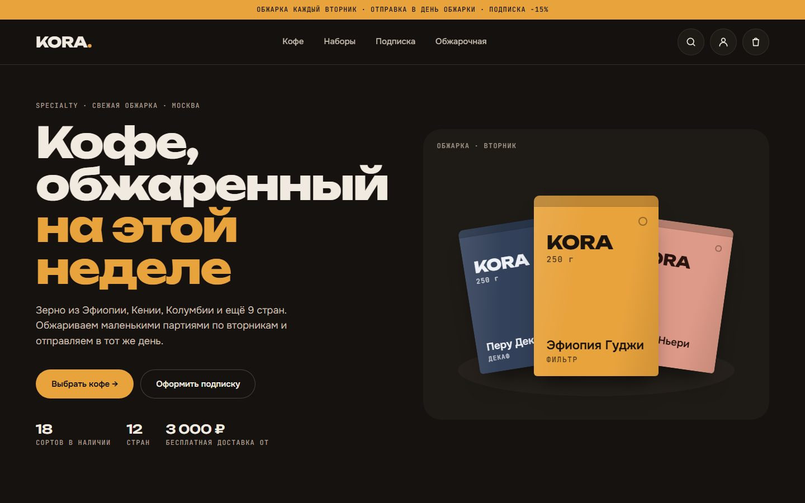
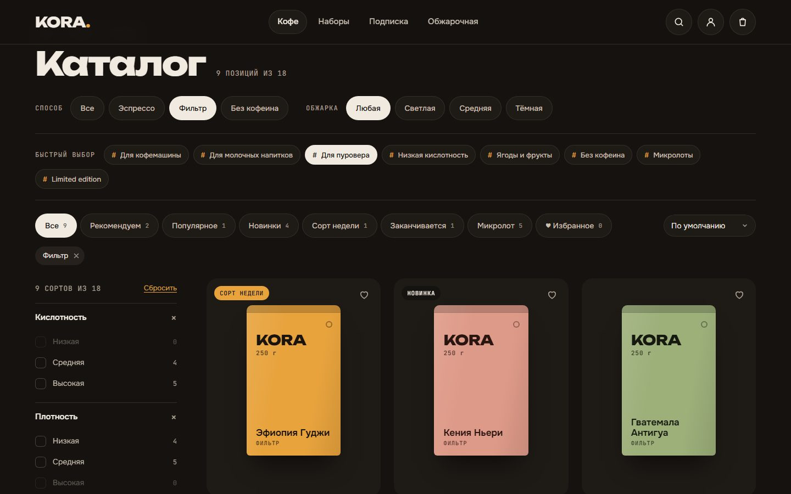
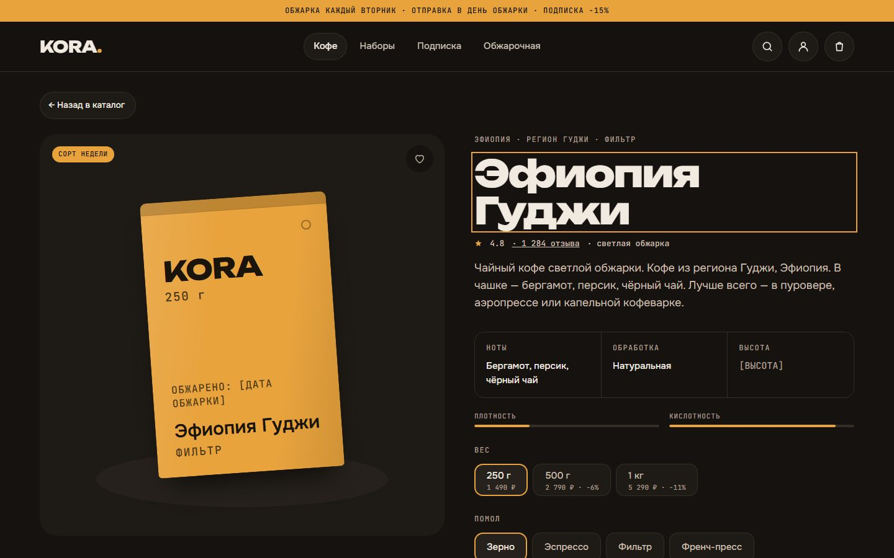
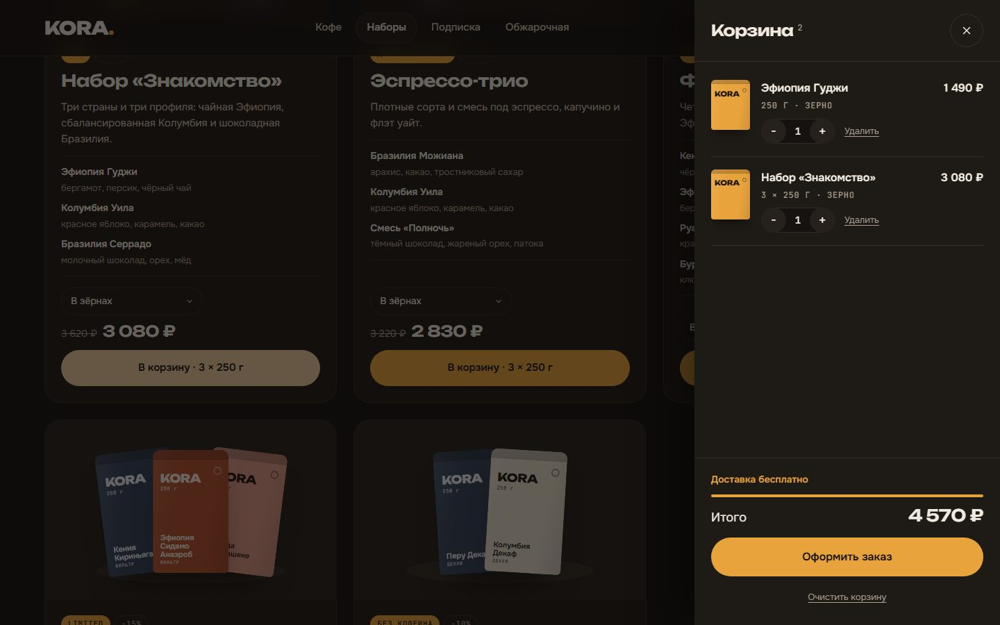
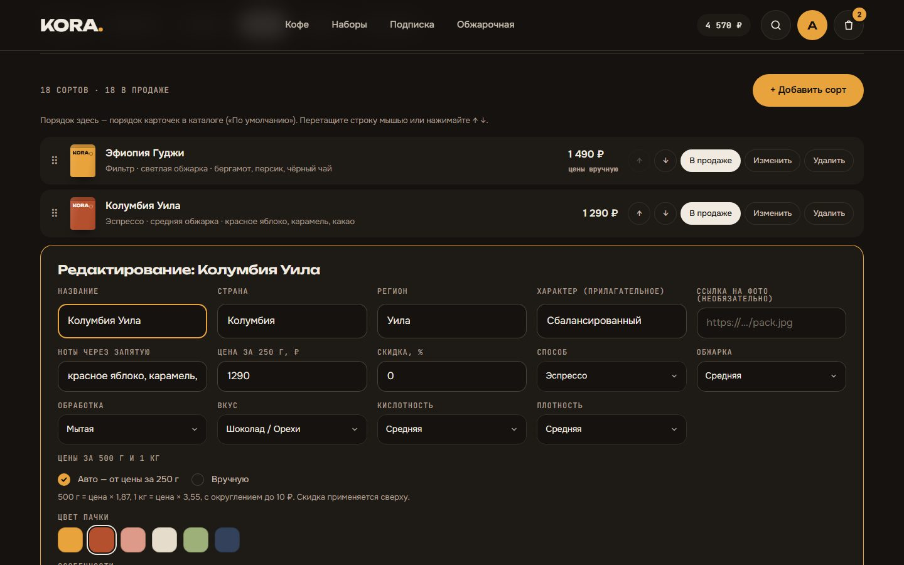
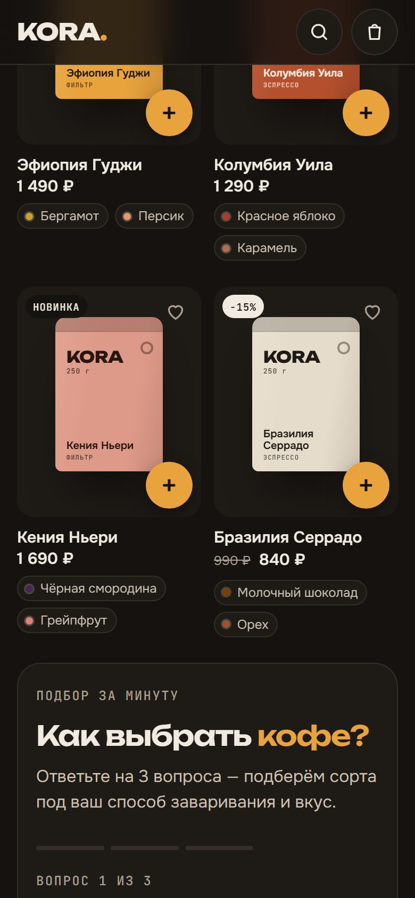

# KORA — интернет-магазин specialty-кофе

Полноценный интернет-магазин вымышленной обжарочной **KORA**: каталог с фильтрами, корзина, аккаунты, заказы, отзывы и админка.
Бэкенд — чистый Node.js со встроенным SQLite, фронтенд — ванильный JavaScript без сборки. **Ноль npm-зависимостей**: клонировали → `npm start` → работает.




---

## Возможности

**Для покупателя**
- каталог с фильтрами (способ, обжарка, кислотность, плотность, вкус, страна…), подборками, сортировкой и поиском — состояние фильтров живёт в URL, ссылкой можно поделиться;
- квиз «Как выбрать кофе»: три вопроса → три подходящих сорта;
- выбор веса (250 г / 500 г / 1 кг) и помола прямо в карточке, наборы из нескольких сортов со скидкой;
- корзина с мгновенным откликом: изменения видны сразу, а при ошибке сервера откатываются;
- регистрация и вход, избранное, история заказов со статусами, отзывы с оценкой 1–5;
- адаптивная вёрстка с нижней навигацией на телефоне, установка как приложение (PWA), просмотр каталога без сети.

**Для администратора**
- сорта: добавление, редактирование, фото по ссылке, цены за 500 г / 1 кг — по формуле или вручную, скрытие и удаление;
- порядок карточек в каталоге — перетаскиванием мышью или стрелками;
- наборы: состав, скидка, описание, порядок;
- заказы всех покупателей и смена статуса: новый → в обжарке → отправлен → доставлен;
- модерация отзывов.

| Каталог | Страница сорта |
|---|---|
|  |  |
| **Корзина** | **Админка** |
|  |  |

<p align="center"></p>

---

## Быстрый старт

Нужен **Node.js 22.13 или новее** (проверено на 24.x) — в нём есть встроенный `node:sqlite`.

```bash
git clone <адрес-репозитория> kora
cd kora
npm start
```

Откройте **http://localhost:3000**. `npm install` не нужен.

При первом запуске создаётся база `data/kora.db` с 18 сортами и 5 наборами, а также администратор:

| Email | Пароль |
|---|---|
| `admin@kora.local` | `kora-admin` |

Админка — в личном кабинете, вкладки «Сорта», «Наборы», «Все заказы». Пароль смените в профиле или задайте свой через `ADMIN_PASSWORD` до первого запуска.

```bash
npm run dev       # перезапуск при изменении файлов
npm run reset-db  # удалить базу (сервер должен быть остановлен); при старте создастся заново
```

<details>
<summary><b>Переменные окружения</b></summary>

| Переменная | По умолчанию | Назначение |
|---|---|---|
| `PORT` | `3000` | порт HTTP-сервера |
| `DB_FILE` | `data/kora.db` | файл SQLite (`:memory:` — база в памяти) |
| `ADMIN_EMAIL` | `admin@kora.local` | администратор, создаётся при старте, если его нет |
| `ADMIN_PASSWORD` | `kora-admin` | его пароль |
| `COOKIE_SECURE` | — | `1` — cookie с флагом `Secure` (за HTTPS) |

```powershell
# PowerShell
$env:PORT = 8080; $env:ADMIN_PASSWORD = 'длинный-пароль'; npm start
```
```bash
# bash
PORT=8080 ADMIN_PASSWORD='длинный-пароль' npm start
```
</details>

---

## Стек и архитектура

| | |
|---|---|
| Сервер | `node:http` — свой маленький роутер, статика и JSON API |
| База | `node:sqlite` (SQLite в режиме WAL), транзакции, триггеры на статусы заказов |
| Фронтенд | ванильный JS, hash-роутинг, рендер через шаблонные строки, без сборки |
| Офлайн | service worker «сначала сеть», копия каталога в `localStorage` |
| Безопасность | `scrypt`, сессии в httpOnly-cookie, защита от CSRF, rate limit |

```
server/
  server.js   HTTP-сервер: статика из site/ и JSON API под /api
  db.js       схема SQLite, транзакции, первичное наполнение, админ по умолчанию
  seed.js     стартовые сорта и наборы — копируются в пустую базу один раз
  auth.js     пароли (scrypt), токены сессий, cookie
site/
  index.html  каркас страницы
  css/        стили (тёмная тема, адаптив)
  js/data.js  справочники и формулы цен — общие для браузера и сервера
  js/api.js   клиент API, кеш каталога для работы без сети
  js/app.js   роутер, каталог, корзина, кабинет, оформление, отзывы, админка
  sw.js, manifest.webmanifest, icons/   PWA
docs/         скриншоты для README
```

### Ключевые решения

**Одна формула цены на клиенте и сервере.** `site/js/data.js` — обычный браузерный скрипт; сервер исполняет его в песочнице `node:vm`. Цена в карточке и цена в заказе считаются одним и тем же кодом, а при оформлении сервер пересчитывает всё сам — клиентским суммам он не доверяет и сохраняет снимок позиций.

**Оптимистичная корзина.** Действие сразу применяется к интерфейсу и встаёт в очередь на сервер; пока запрос идёт, видна полоса «Синхронизация с магазином…». Быстрые клики по −/+ склеиваются в один запрос. При ошибке операция выбрасывается из очереди — состояние откатывается само. Проверить: откройте `http://localhost:3000/?fail=0.5` — половина запросов будет «падать».

**Каталог только в базе.** Сорта и наборы хранятся в таблицах `products` и `bundles`; `seed.js` нужен лишь для пустой базы. Сервер держит каталог в памяти и сбрасывает кеш при правках в админке, а изменения из других процессов замечает по `PRAGMA data_version`.

**Гость → аккаунт.** У гостя корзина привязана к httpOnly-cookie. При входе она сливается с корзиной аккаунта, а избранное из `localStorage` переезжает на сервер.

**Целостность данных.** Многошаговые операции идут в транзакциях `BEGIN IMMEDIATE`, у базы задан `busy_timeout`. Скрытый сорт исчезает из каталога, корзин и наборов; удалённый — ещё и из избранного и отзывов, а уже оформленные заказы не меняются. Сорт, который входит в набор, удалить нельзя.

**Безопасность.**
- пароли — `scrypt` с солью, сравнение за постоянное время;
- сессия — случайный токен в httpOnly-cookie `SameSite=Lax`, в базе хранится только его SHA-256;
- мутирующие запросы принимают только `application/json` — HTML-форма с чужого сайта такой не отправит (CSRF);
- вход и регистрация — не больше 20 попыток за 10 минут с одного IP;
- ссылки на фото товаров проверяются, статика отдаётся только из `site/`.

<details>
<summary><b>Страницы</b></summary>

| Адрес | Что там |
|---|---|
| `#/` | главная: hero, хиты продаж, наборы |
| `#/catalog` | каталог: фильтры, подборки, сортировка, квиз, пагинация |
| `#/catalog?method=filter&acidity=high` | каталог с фильтрами — ссылкой можно поделиться |
| `#/product/ethiopia-guji` | страница сорта с отзывами |
| `#/sets` | наборы |
| `#/subscription`, `#/about` | подписка, обжарочная |
| `#/account/orders`, `/favorites`, `/profile` | личный кабинет |
| `#/account/admin-products`, `/admin-bundles`, `/admin-orders` | админка (роль `admin`) |
| `#/checkout` | оформление заказа |
</details>

<details>
<summary><b>API</b></summary>

Все ответы — JSON. Мутирующие запросы принимают только `Content-Type: application/json`.

| Метод | Путь | Доступ | Описание |
|---|---|---|---|
| GET | `/api/health` | все | бэкенд жив |
| GET | `/api/catalog` | все | активные сорта и доступные наборы |
| GET | `/api/products/:handle` | все | один сорт |
| GET | `/api/products/:handle/reviews` | все | отзывы о сорте (`mine: true` — свой) |
| POST | `/api/products/:handle/reviews` | пользователь | `{ rating: 1–5, text }` — один отзыв на сорт, повтор обновляет |
| DELETE | `/api/reviews/:id` | автор или админ | удалить отзыв |
| GET | `/api/cart` | все | корзина гостя (cookie) или пользователя |
| POST | `/api/cart/ops` | все | `{ type: 'add' \| 'set' \| 'remove', variantId, qty }` или `{ type: 'clear' }` |
| POST | `/api/auth/register` | все | `{ name, email, password }`, сразу входит |
| POST | `/api/auth/login` | все | `{ email, password }` |
| POST | `/api/auth/logout` | все | завершить сессию |
| GET / PATCH | `/api/me` | пользователь | профиль / `{ name, phone, address }` |
| POST | `/api/me/password` | пользователь | `{ current, next }`, разлогинивает другие устройства |
| GET | `/api/favorites` | пользователь | список `handle` |
| PUT / DELETE | `/api/favorites/:handle` | пользователь | добавить / убрать |
| GET / POST | `/api/orders` | пользователь | история / заказ из текущей корзины `{ name, phone, address, comment }` |
| GET / POST | `/api/admin/products` | админ | все сорта / создать сорт |
| PUT / DELETE | `/api/admin/products/:handle` | админ | изменить (`active`, `image`, `prices: { 500, 1000 } \| null`) / удалить |
| PUT | `/api/admin/products-order` | админ | `{ handles: [...] }` — порядок карточек |
| GET / POST | `/api/admin/bundles` | админ | все наборы / создать `{ handle, title, tag, desc, discount, items }` |
| PUT / DELETE | `/api/admin/bundles/:handle` | админ | изменить / удалить набор |
| PUT | `/api/admin/bundles-order` | админ | `{ handles: [...] }` — порядок наборов |
| GET | `/api/admin/orders` | админ | все заказы |
| PATCH | `/api/admin/orders/:id` | админ | `{ status: 'new' \| 'roasting' \| 'shipped' \| 'done' \| 'cancelled' }` |

Вариант товара (`variantId`): сорт — `handle|вес|помол` (`kenya-nyeri|250|beans`), набор — `set:handle|помол` (`set:starter|filter`).
</details>

---

## Что осталось заглушкой

- оплата: заказ оформляется «с оплатой при получении», платёжного шлюза нет;
- подписка на кофе — кнопка отвечает «скоро»;
- письма (подтверждение заказа, восстановление пароля) не отправляются;
- тексты, которые нельзя выдумывать за реальную обжарочную, помечены плейсхолдерами: `[АДРЕС ОБЖАРОЧНОЙ]`, `[EMAIL]`, `[ВЫСОТА]`, `[ИСТОРИЯ ФЕРМЫ И ФЕРМЕРА]`, `[УСЛОВИЯ ДОСТАВКИ]`.

Для продакшена: поставить сервер за HTTPS-прокси с `COOKIE_SECURE=1`, сменить пароль администратора, настроить резервное копирование `data/kora.db`.

KORA — вымышленный бренд; все сорта, цены и отзывы в демо-данных выдуманы.
